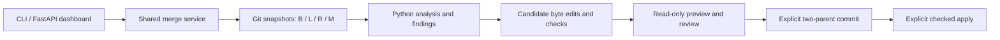

# MergeRisk 2.0

A local-first semantic Git merge assistant for Python. Catch mechanical integration errors that survive a clean textual merge, inspect exact repairs, and explicitly create a controlled merge commit.

The hosted beta analyzes public GitHub repositories and offers verified repair patches through the browser. See the [hosted deployment and access contract](docs/HOSTED_DEPLOYMENT.md).

## Three-command quickstart

Requires Python 3.10+, Git 2.43+, and an existing local Git repository. Run with your intended Python environment active:

```text
python -m pip install .
mergerisk doctor
mergerisk dashboard
```

Open the private dashboard link printed by `mergerisk dashboard`. Register a repository, select target/source branches, analyze, inspect findings and B/L/R/M/fixed source comparisons, then explicitly create a commit. Applying it is a separate action. No Node installation or frontend build is needed.

For an isolated Windows installation, first run `python -m venv .venv` and activate it with `.\.venv\Scripts\Activate.ps1`. The dashboard runs locally; it does not require a hosted service or an account.

## How it works

The CLI and dashboard share one `MergeService`. Git supplies four immutable versions: **B** (common base), **L** (target), **R** (source) and **M** (Git's proposed merge). Comparing all four helps distinguish a merge-introduced problem from one already present on a parent branch.

Python syntax trees, compiler scopes, imports and call relationships provide evidence for findings. Repairs edit exact source byte spans in a separate candidate; syntax, scope, argument-expression and regression checks must pass before a proposal is retained. Original files are never rewritten just to format an AST.



FastAPI serves bundled HTML/CSS/JavaScript; SQLite stores local history and review decisions. A bounded job queue keeps analysis off HTTP request handlers. Optional Docker verification is separate from static analysis. See [architecture](docs/ARCHITECTURE.md) and [engineering decisions](docs/DECISIONS.md) for implementation details and tradeoffs.

## What ships

- Four-revision Python analysis with exact locations, branch provenance, coverage and beginner explanations.
- Historical missing/stale import detection, conservative rename/name/duplicate diagnostics, signature binding, syntax/deletion/shared-global rules.
- AUTO restoration of a uniquely justified historical import and proven keyword parameter alpha-renames that preserve argument expressions. Byte edits preserve comments, encoding, BOM and line endings.
- SUGGEST reference changes require acceptance. Ambiguous changes, unknown values, function bodies and unsafe patches stay REPORT_ONLY.
- Read-only previews; immutable two-parent commits under unique refs/mergerisk references; explicit checked fast-forward with Git ref locks and rollback checks.
- Bundled dashboard, authenticated loopback API, bounded jobs/cancellation, SQLite history/export, review and optional isolated Docker checks.

## CLI

```text
mergerisk analyze --repo PATH --left main --right feature --format json
mergerisk merge --repo PATH --left main --right feature
mergerisk merge --repo PATH --left LEFT_SHA --right RIGHT_SHA --create-commit
mergerisk merge --repo PATH --left LEFT_SHA --right RIGHT_SHA --create-commit --apply
mergerisk explain MR-PY-IMPORT-001
python -m mergerisk --help
```

Analyze and preview never change the index, checkout or refs. Git may create unreachable merge-tree objects. Use immutable SHAs or --expected FINGERPRINT to pin a reviewed preview. Commit creation needs configured Git user.name/user.email. Apply requires the exact target HEAD, a clean index/worktree including untracked and ignored files, and the supported Git files ref backend; symlinks/submodules and external checkout filters are refused. Detached HEAD analysis and commit creation are supported.

Exit codes: **0** completed preview/action (inspect coverage); **1** operational failure/refusal; **2** textual conflict; **3** findings from analyze or unresolved blockers in merge preview. The legacy fixture command retains exit 0 for completed analysis.

## Verification and limits

Static analysis never executes project code. Runtime checks require an explicit trusted immutable Docker image and argument array, with network disabled, read-only snapshots, non-root user and resource limits. Without a working sandbox the result is validation_unavailable; there is no host fallback.

No supported findings is not a universal safety claim. Dynamic dispatch, wildcard/optional imports, annotation-sensitive scopes, comprehensions, runtime namespace operations and unresolvable star arguments reduce coverage. Automatic import repair is limited to one binding in an unchanged module import prologue. Typo/structural rename suggestions cannot prove identity; duplicate definitions/imports are diagnostic only. See [supported scope](docs/USER_GUIDE.md).

The latest recorded release-readiness run was **2026-11-17**, on Windows 11, Python 3.13.5 and Git 2.55.0.windows.3:

- Fresh non-editable installation: **183 tests and 32 subtests passed** in 88.51 seconds. A separate installed-wheel security/repair/Git/API run passed 48 tests in 47.07 seconds; this overlaps the full suite. Both runs reported one upstream Starlette/httpx deprecation warning.
- Repair evaluator: **13 authored cases**, with 5/5 byte-exact automatic fixes, 7/7 correct refusals, one clean control and zero false fixes. Independent assertions checked untouched source spans and argument expressions. This is evidence for these cases, not proof of arbitrary business-logic equivalence.
- Built wheel and source distribution; verified fresh non-editable source and wheel installations. All 47 installed package payload files matched the wheel. Both environments passed `pip check`.
- Real Git merge demonstration passed exact-byte, two-parent, explicit-apply and unsafe-refusal checks. Read-only analyze/preview preserved 304 user-file hashes plus HEAD, refs, index and Git configuration.
- Installed dashboard passed 98 logged real TCP HTTP requests and a separate browser registration-to-apply workflow, including review, history/export, cancellation, dirty-checkout refusal and authentication/CSRF/Origin/Host checks.

The [release-readiness report](reports/readiness-20261117-68e5ed73/REPORT.md) records exact commands, outputs, package hashes and evidence. These are dated executed results, not a claim that tests run automatically on every checkout. Linux/macOS, other Python versions and remote CI were not executed in that verification. Docker's daemon was unavailable, so actual container execution remains unverified; unavailable validation never falls back to executing repository code on the host.

## Try the LedgerFlow dashboard fixture

This workspace also has a separate, generated Git repository at `.test-runs/ledgerflow-dashboard-demo`. Register its absolute path in the dashboard. It models a fictional multi-tenant billing application with SQLite transactions, idempotent invoices, a transactional outbox, HMAC webhooks, background-job leases and a local authenticated API. Data and secrets are synthetic; it is test code, not a payment deployment.

- **Mixed errors:** target `platform/refactor`, source `feature/renewal-worker`. Both parents pass their tests, but their clean textual merge has four integration errors: a missing import (AUTO), renamed keyword (AUTO), stale function reference (SUGGEST), and missing required currency argument (REPORT_ONLY). Inspect the automatic fixes and explicitly accept or reject the rename. The currency value requires a human decision, so commit creation remains blocked.
- **Repairable merge:** target `platform/import-cleanup`, source `feature/outbox-export`. One missing import is repaired automatically; the repaired candidate passed all 10 application tests. Review coverage and acknowledge partial analysis if required before creating a commit.
- **Clean control:** target `main`, source `feature/outbox-export`. No merge-introduced findings were reported.

The fixture's `demo/broken-merge` branch is already broken and exists for manual inspection. Use the parent pairs above to demonstrate merge-induced defects. Fixture files and verification evidence live under ignored `.test-runs/`: they are local workspace artifacts, **not included in a fresh clone or the distribution package**. For a reproducible demo shipped with this project, run `python scripts/demo.py`.

## Reproduce the checks

```text
python -m pip install -e ".[test]"
python -m pytest -q
python tests/run_eval.py
python scripts/evaluate_repairs.py
python scripts/demo.py
python scripts/benchmark.py --output reports/benchmark-local.json
```

The authored repair corpus contains exact golden outputs, clean controls and must-refuse cases. Its zero-false-fix gate applies only to that corpus. See [repair evaluation](reports/evaluation/repairs.json) and the latest [Git demo evidence](reports/readiness-20261117-68e5ed73/demo.json).

The latest [idle benchmark](reports/readiness-20261117-68e5ed73/benchmark-idle.json) measured full previews at **0.9471 / 1.2433 / 2.2492 seconds** for 10 / 50 / 200 Python files per revision, including repair checks. The 200-file snapshot took 1.2291 seconds; full-preview Python heap peak was 1.566 MiB, excluding Git child processes and OS buffers (not total RSS). These are single local samples with uncontrolled OS caches, not a universal timing promise. Historical [before](reports/benchmark-before.json) and [after](reports/benchmark-after.json) measurements document the earlier batching optimization.

[User guide](docs/USER_GUIDE.md) · [Architecture](docs/ARCHITECTURE.md) · [Testing](docs/TESTING.md) · [Security](docs/SECURITY.md) · [Decisions](docs/DECISIONS.md) · [Progress](docs/PROGRESS.md) · [Changelog](CHANGELOG.md)

Existing detector compatibility modules/tests remain supported. No new open-source license has been asserted for this repository.
