# Implemented architecture

CLI and FastAPI invoke one MergeService. The dashboard adds local sessions, bounded jobs and SQLite history.

```mermaid
flowchart LR
    UI[CLI or local dashboard] --> Service[MergeService]
    Service --> Git[Bounded Git plumbing]
    Git --> Snap[B / L / R / M immutable bytes]
    Snap --> AST[Cached AST / compiler scopes]
    AST --> Rules[Attribution / resolution / rules]
    Rules --> Plan[Exact tiered repair proposals]
    Plan --> Verify[Atomic edits / static invariants]
    Verify --> Preview[Read-only preview]
    Preview --> Commit[Explicit commit-tree / artifact ref]
    Commit --> Apply[Explicit locked fast-forward]
```

git/scenario.py resolves unique bases and uses merge-tree authority. git/plumbing.py bounds subprocess time/output, sanitizes inherited Git redirection/configuration, batches blobs and provides prepared ref transactions. Global author identity is read as data only; operations do not enable global hooks/signing/filters/drivers.

GitSnapshotReader caches by immutable object ID and resolves symbolic revisions afresh. Inventory prefetches eligible blobs in batches. AnalysisOrchestrator.analyze delegates to the same source pipeline as fixture/product analysis.

Existing attribution, import/symbol/call graph and shared-global foundations remain. The Python adapter adds compiler-aware lexical evidence and explicit limitations. Parsed trees are reused by read-only visitors and call-site lookup. Attribution normalizes a private AST because its docstring normalizer mutates nodes. Bounded caches use exact source/path keys; repair verdicts are never reused across trees.

Findings retain stable IDs, roles, relationships, exact locations and provenance. Repeated call-site alerts are grouped with all locations/evidence. Pre-existing name/syntax/signature defects are separate. Comparable parent calls/entities are checked before attributing a defect.

repair.py proposes exact byte spans. Historical imports and narrow keyword alpha-renames can be AUTO. Rename/typo candidates require review. Verification checks hashes, overlap, compiler syntax, allowed AST sites, supported name/signature regressions, cycles, finding removal, severity regressions and idempotency. A failed check rejects the entire candidate patch. Full-file unparsing is never used for edits.

Artifact creation re-runs the immutable preview and compares bytes/fingerprint. A private index preserves unedited entries/modes. commit-tree creates the exact two-parent artifact; compare-and-swap creates a unique refs/mergerisk/UUID. Apply uses prepared Git ref/HEAD locks, checked read-tree and checked rollback on ref commit failure.

The loopback dashboard uses registered IDs, HTTP-only SameSite sessions, CSRF, Origin/Host/body checks and escaped templates. One worker/four total jobs bounds concurrency. SQLite stores results, revision IDs, decisions and actions; interrupted jobs become errors on restart.

Optional verification invokes a trusted preinstalled Docker image with fixed restrictions. Repository code never runs on the host. Four-version commands/results are recorded; missing infrastructure is unavailable.

Legacy detector remains because v1_rules and migration tests import its entities/interactions. It is not a second product orchestration path.
